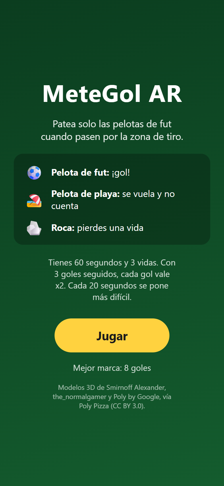
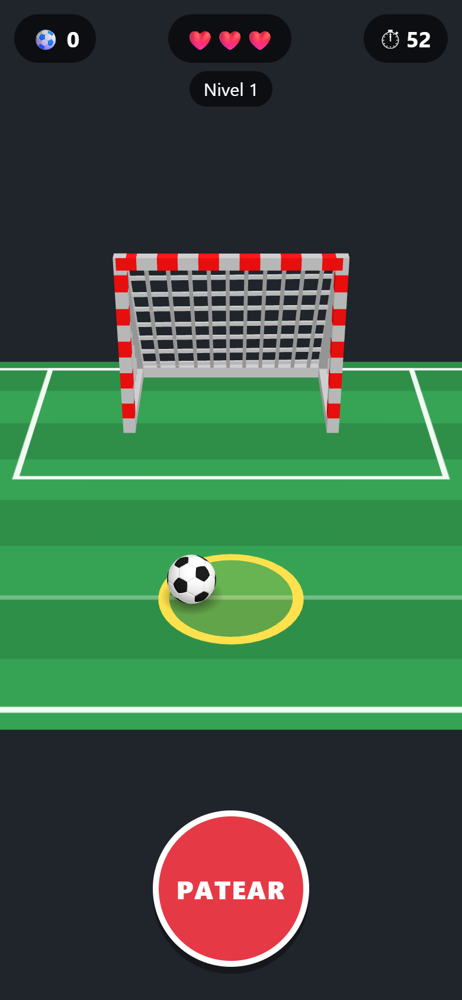
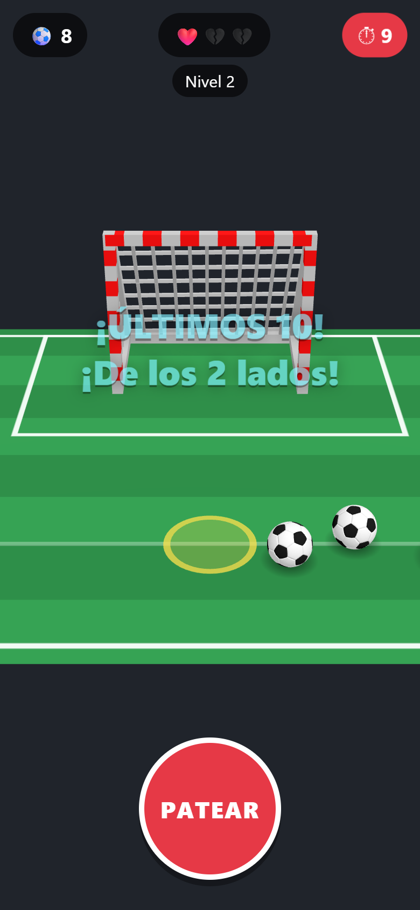
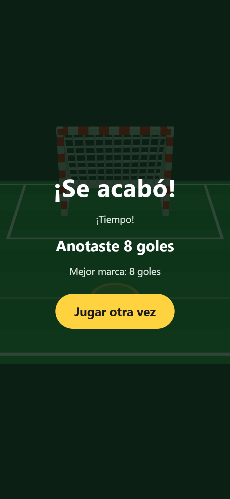

# MeteGol AR

Juego de realidad aumentada para navegador móvil, activado por un marcador QR personalizado. Al apuntar la cámara al marcador aparece una mini cancha con portería: por la zona de tiro pasan rodando pelotas de fut, pelotas de playa y rocas, y tú decides cuándo patear.

**Jugar:** https://juego-ar.hectormarey145.workers.dev/

Actividad 1 del curso de Realidad Virtual y Aumentada: *Juego de Realidad Aumentada activado por marcador QR personalizado*.

## Capturas

| Inicio | Juego | Últimos 10 segundos | Fin |
|---|---|---|---|
|  |  |  |  |

*Capturas de la vista previa sin cámara (`?preview`). En el teléfono la cancha aparece sobre el video, parada sobre el marcador.*

## Cómo se juega

1. Abre el enlace en el celular (o escanea el QR del marcador con la cámara) y toca **Jugar**. Acepta el permiso de cámara.
2. Apunta la cámara al marcador. Sobre él aparece la cancha y empieza la partida.
3. Toca **PATEAR** cuando un objeto esté dentro del círculo amarillo (la zona de tiro):

| Objeto | Si lo pateas en la zona | Si lo dejas pasar |
|---|---|---|
| ⚽ Pelota de fut | **¡Gol!** +1 (o +2 con racha) | No pasa nada |
| 🏖️ Pelota de playa | Se vuela: 0 puntos y se rompe la racha | No pasa nada |
| 🪨 Roca | **Pierdes una vida** y se rompe la racha | No pasa nada |
| (nada) | Patada al aire: se rompe la racha | — |

- **Racha:** con 3 goles seguidos se activa **x2** y cada gol siguiente vale 2.
- **Fin:** la partida dura **60 segundos** o hasta perder las **3 vidas**. Tu mejor marca se guarda en el teléfono.
- **Pausa:** si la cámara pierde el marcador, el juego se detiene hasta que lo vuelvas a enfocar.

### Dificultad

- **Niveles por goles:** con 5 y 10 goles los objetos van más rápido, salen más seguido y hay más rocas.
- **Etapas por tiempo:**

| Quedan | Zona de tiro | Objetos a la vez | Velocidad |
|---|---|---|---|
| 60–40 s | normal | 1 | normal |
| 40–20 s | más chica | 2, uno detrás de otro | un poco más rápido |
| 20–10 s | aún más chica | 2, más seguidos | más rápido |
| 10–0 s | aún más chica | 3, **de los dos lados** | más rápido |

Nunca hay dos objetos dentro de la zona al mismo tiempo, así que cada patada afecta a uno solo.

### Retroalimentación

Cada acción tiene respuesta visual, sonora y, en Android, vibración: el botón se hunde, el gol vuela a la red, la pelota de playa sale disparada, la roca tiembla con un destello rojo y se rompe un corazón, y la patada al aire deja una onda en la zona de tiro. En iPhone el navegador no permite vibrar, y el interruptor de silencio apaga los sonidos.

## Marcador

El marcador es un QR propio (con la URL del juego) dentro de un marco de cancha. Imprímelo o ábrelo en otra pantalla y ponlo **parado** (en una pared o un monitor): la cancha sale hacia ti desde su borde inferior.

- Imagen para imprimir: [`marker/marker.png`](marker/marker.png) *(PENDIENTE: subir la imagen al repositorio)*
- Objetivo compilado para MindAR: [`assets/targets/marker.mind`](assets/targets/marker.mind)

## Tecnologías

- HTML + CSS + JavaScript (ES modules), sin paso de build
- [MindAR](https://github.com/hiukim/mind-ar-js) 1.2.5 (rastreo de imagen) + [three.js](https://threejs.org/) 0.160.0, desde CDN con `importmap`
- GLTFLoader de three.js para los modelos `.glb`
- Web Audio API para los sonidos y Vibration API para la vibración
- Cloudflare Workers (assets estáticos) para publicar con HTTPS

## Estructura

```
index.html          pantallas y HUD
css/style.css       estilos de la UI
js/config.js        todas las constantes ajustables (tiempos, niveles, etapas, tamaños)
js/main.js          arranque: conecta MindAR, la escena, el juego y la UI
js/game.js          lógica: spawns, puntaje, vidas, tiempo, niveles, etapas y racha
js/scene.js         cancha, modelos, rodado, sombras y animaciones
js/ui.js            pantallas, HUD y mensajes
js/feedback.js      sonidos y vibración
assets/             modelos, sonidos y objetivo del marcador
```

## Ejecución local

Es un sitio estático: basta servir la raíz del repositorio.

```bash
npx wrangler dev
```

La cámara solo funciona en `localhost` o por HTTPS, así que para probar con el celular se usa la versión publicada.

Para ver la cancha sin cámara ni marcador (se gira con el ratón), abre la página con `?preview`, por ejemplo `http://localhost:8787/?preview`.

## Publicación

El repositorio está ligado a Cloudflare: cada push a `main` publica el sitio en https://juego-ar.hectormarey145.workers.dev/.

## Créditos

### Modelos 3D

Todos de [Poly Pizza](https://poly.pizza), con licencia [CC BY 3.0](https://creativecommons.org/licenses/by/3.0/).

| Archivo | Modelo | Autor | Fuente | Licencia |
|---|---|---|---|---|
| `soccer_ball.glb` | Simple soccer football | Smirnoff Alexander | [poly.pizza/m/57u6P7Sr7K0](https://poly.pizza/m/57u6P7Sr7K0) | CC BY 3.0 |
| `beach_ball.glb` | beach ball | the_normalgamer | [poly.pizza/m/4IwPTeOmq6c](https://poly.pizza/m/4IwPTeOmq6c) | CC BY 3.0 |
| `rock.glb` | Boulder | Poly by Google | [poly.pizza/m/3jql0qtape-](https://poly.pizza/m/3jql0qtape-) | CC BY 3.0 |
| `goal.glb` | Soccer goal | Poly by Google | [poly.pizza/m/7t4hmicGHV4](https://poly.pizza/m/7t4hmicGHV4) | CC BY 3.0 |

Los modelos se usan reescalados y reorientados en el código; los archivos no se modificaron.

### Sonidos

`click`, `kick`, `goal`, `boing`, `hit`, `whoosh`, `levelup` y `gameover`: sonidos originales creados por síntesis para este proyecto.

### Librerías

[MindAR](https://github.com/hiukim/mind-ar-js) (MIT) y [three.js](https://github.com/mrdoob/three.js) (MIT).

## Autor

[@HectorMtzR](https://github.com/HectorMtzR) *(PENDIENTE: nombre completo)*
